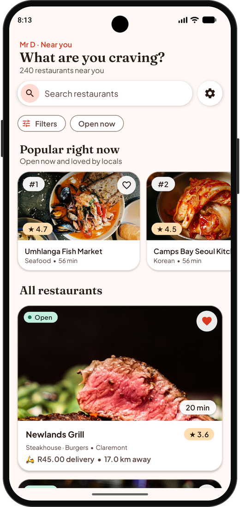
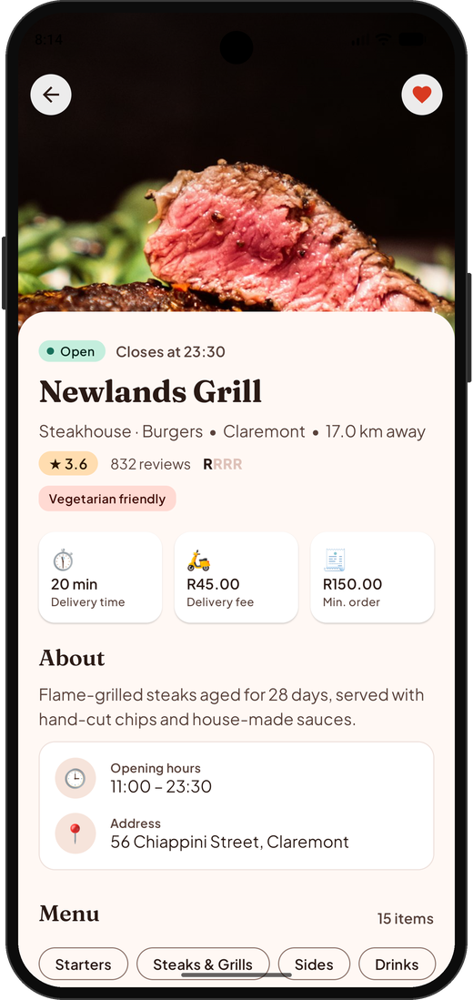
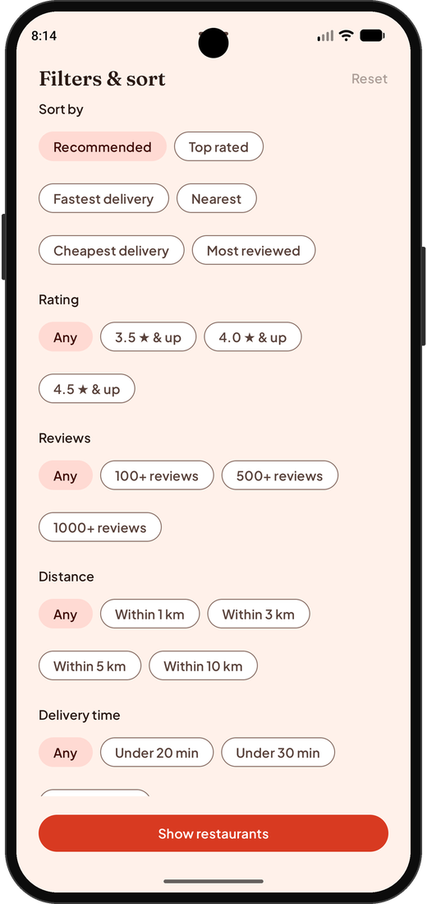
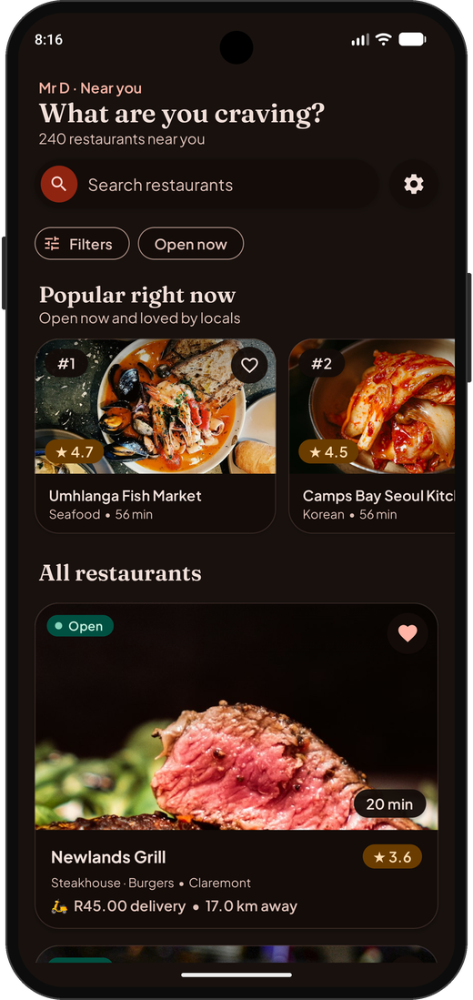
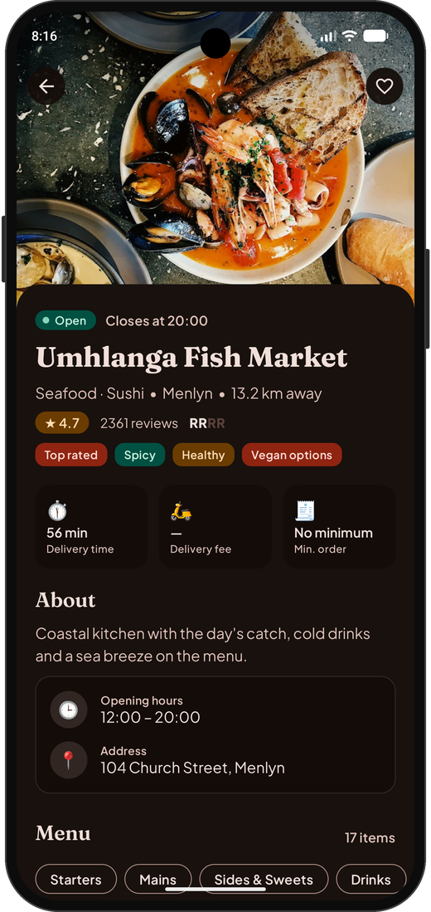
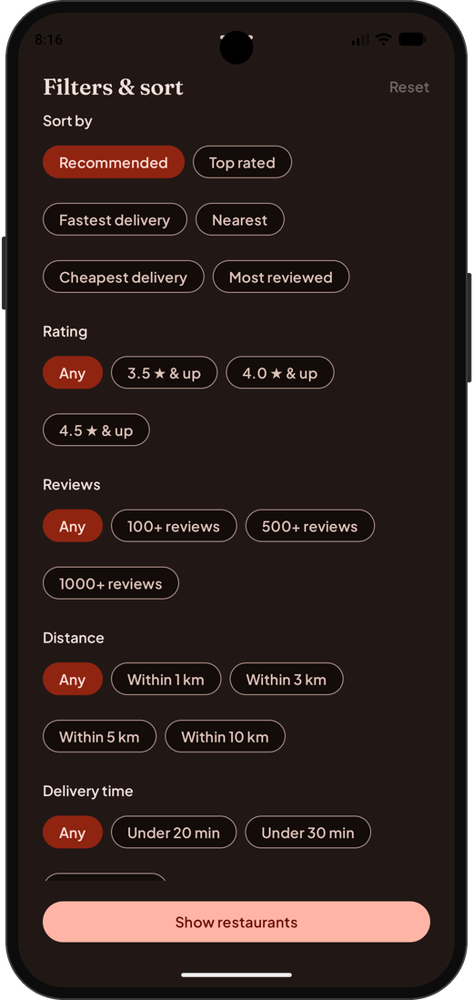

# Mr D Restaurants — Restaurant Discovery MiniApp

Kotlin + Jetpack Compose, MVVM with a repository layer. Room is the single source of truth; the
network only refreshes it. Design rationale and trade-offs: **[SOLUTION.md](SOLUTION.md)**.

## Screenshots

Light and dark themes: list, details, filters.

<p align="center">
  
  
  
</p>

<p align="center">
  
  
  
</p>

## What it does

- Browse list: name, cuisines, rating, ETA, open/closed, delivery fee, distance, photo
- Search by name, "Open now" toggle, and a Filters sheet (sort, rating, reviews, distance, ETA,
  fee, price, cuisine, dietary). Filters are applied live and remembered across restarts
- "Popular right now" carousel; collapsing header with search, settings and filters pinned
- Details page: hero photo, stats, about, hours, address, menu with pinned category chips
- Loading, empty, error and offline states; retry; last good list always available offline
- Favourites (persisted), Settings (theme: system/light/dark), deep link `mrd://restaurant/{id}`
- State survives rotation, process death and cold restart
- 240 mock restaurants (some deliberately dirty) and about 3,400 menu items, served by an in-app
  OkHttp interceptor through a real Retrofit call

## Run it

Android Studio Ladybug (2024.2) or newer, JDK 17, emulator or device on API 24+. No API keys.

```bash
./gradlew installDebug      # or just press Run in Android Studio
```

Photos are hotlinked from Unsplash. If one fails or you are offline with nothing cached, a
cuisine-matched photo and then an emoji gradient are used.

## Try the interesting behaviours

**Offline and errors (debug builds):** Settings → Developer options → *Network: offline* or
*server error*, then pull to refresh or tap *Try again*. The list stays on screen with a banner.
To see the hard error state, clear app storage first, then go offline and launch.

**Menu states:** `r-1020` has broken menu entries, `r-1034` has an empty menu, `r-1049` returns 404.

**Deep link** (works with the app open or closed):

```bash
adb shell am start -a android.intent.action.VIEW -d "mrd://restaurant/r-1001"
adb shell am start -a android.intent.action.VIEW -d "mrd://restaurant/does-not-exist"   # not found
```

## Tests

```bash
./gradlew testDebugUnitTest            # mappers, formatting, ViewModels
./gradlew connectedDebugAndroidTest    # Room DAO and migrations, needs a device/emulator
./gradlew lintDebug
```

## Layout

```
app/src/main/java/com/example/mrd/
├── core/ domain/        dispatchers; models + repository contracts (no Android deps)
├── data/                remote (Retrofit, mock server), local (Room, DataStore), mappers, repository
├── di/                  Hilt modules
└── ui/                  browse, detail, favorites, settings, components, navigation, theme
```

Regenerate mock data: `python3 scripts/generate_restaurants.py 240`.
Versions are pinned in `gradle/libs.versions.toml`.

**Database:** Room schema v3, with `@AutoMigration`s from v1 and v2 so favourites survive upgrades.
Keep `app/schemas/` committed; `MigrationTest` reads it.

Fonts (Plus Jakarta Sans, Fraunces) are bundled under the SIL OFL; licences are in `docs/licenses`.
